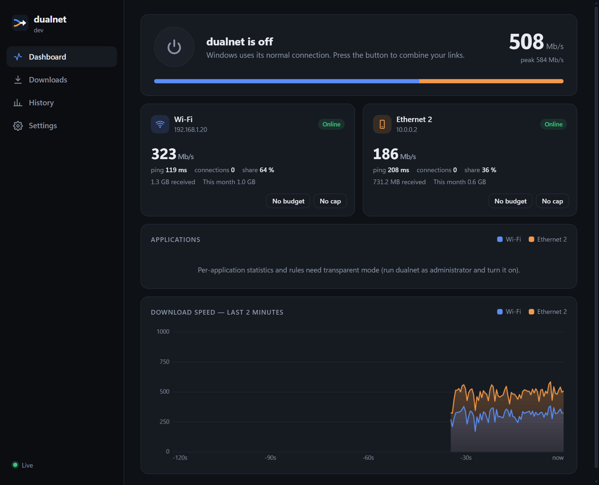
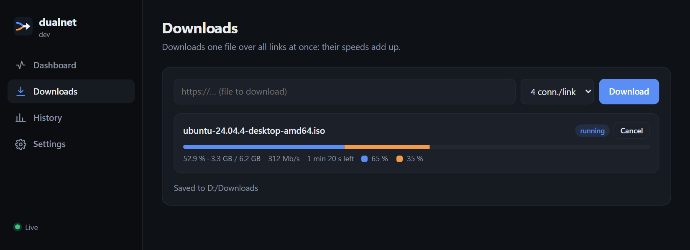

<div align="center">


# dualnet

**Combine several internet connections on one Windows PC, with no remote server.**<br>
Home Wi‑Fi + phone USB tethering + Ethernet: use them all at once.

[](https://github.com/NassB/dualnet/actions/workflows/build.yml)
[](https://github.com/NassB/dualnet/releases/latest)
[](LICENSE)


[Download](#download) · [Quick start](#quick-start) · [Features](#what-dualnet-does) · [Command line](#command-line) · [Security](#security) · [Contributing](CONTRIBUTING.md)

<br>



</div>

## Highlights

- 🔀 **Spreads connections by measured speed**: every new connection goes to the link with the most free capacity.
- 🖥️ **Transparent mode**: a virtual adapter (Wintun) captures the whole PC's IPv4 traffic, no per-app settings.
- ⚡ **Faster downloads**: one big file is fetched over all links at once, so speeds add up.
- 📱 **Overflow, caps and budgets**: keep your phone's mobile data idle until it is needed, cap speeds, set a monthly budget per link.
- 🎯 **Per-application rules**: pin a game to Wi‑Fi or to whichever link has the lowest ping, limit a download's speed.
- 🛟 **Failover**: a link that stops answering is set aside within seconds, and a new connection never waits for it: the next link is tried after a fraction of a second.
- 🔒 **Local only**: no account, no server, no telemetry. The dashboard is bound to `127.0.0.1` and protected against CSRF and DNS rebinding.
- 🌍 **Interface in English, French, Spanish and German.** The Spanish and German texts have not been reviewed by native speakers: corrections and new languages are welcome (see [CONTRIBUTING](CONTRIBUTING.md#translating)).

## How it works

dualnet needs no server: it runs on your PC and decides, connection by connection, which of your links (Wi‑Fi, USB tethering, Ethernet) carries it. Each new connection goes to the link with the most free capacity, so *several* connections (a download, a game launcher, a browser with many tabs) end up using *all* your links at once. A big file can even be split over every link, so the speeds add up.

<div align="center">
<br>
<sub>A real run: a 6.2 GB file at about 500 Mb/s, home Wi‑Fi (about 320 Mb/s) plus a phone on USB tethering (about 190 Mb/s).</sub>
</div>

What to expect: because there is no server that merges the links back into one, **a single connection** (one video stream, one online game) still uses one link at a time. dualnet makes everything that opens many connections faster, and keeps working if one link drops. See [Limits](#limits).

**Requirements:** Windows 10 or 11, 64-bit. Administrator rights for transparent mode (the other modes work without). At least two links to gain speed; one link works too, with the per-application and budget features.

## Download

Get `dualnet.exe` from the [latest release](https://github.com/NassB/dualnet/releases/latest). It is a single file: run it where it is, or install it properly with `dualnet install` (administrator: copies it to Program Files, adds a Start Menu entry and an "Apps & features" entry; `dualnet uninstall` removes it again, see [Command line](#command-line)).

> The executable is not code-signed, so Windows SmartScreen may warn the first time: click **More info → Run anyway**. You can check the download against the published checksum and build attestation (see [Verifying a download](#verifying-a-download)), or build it yourself (see [Development](#development)).

> **Linux and macOS (experimental):** each release also has `dualnet-linux-*` and `dualnet-darwin-*` binaries (amd64, arm64). Only the **proxy** (`dualnet proxy`), `get` and the web interface (`dualnet ui -open=false`, then open the printed address) are available. There is no transparent mode, per-application statistics, tray icon or installer outside Windows, and it is only lightly tested on those systems (the test suite runs on Linux and macOS in CI). Run `chmod +x` on the file first; on macOS you may need to clear the quarantine flag (`xattr -d com.apple.quarantine`).

## Quick start

Double-click `dualnet.exe`:

1. Windows asks for administrator rights (needed by transparent mode);
2. **dualnet's window opens** (its own app window, no browser) and an icon appears in the notification area;
3. press the big **power button** to turn dualnet on or off. When on, all the PC's IPv4 traffic (games, downloads, browser…) is spread over your links; when off, Windows uses its normal connection. Your choice is remembered.

Closing the window keeps dualnet running in the notification area; open it again from the icon. **Quit** in the icon's menu stops dualnet and restores normal networking.

The window uses Microsoft Edge WebView2, built into Windows 11 and most up-to-date Windows 10 PCs. Without it, the interface opens in your browser instead.

The icon in the notification area is in colour while dualnet is on and grey when it is off; hover it for the live download speed (total and per link).

On a first run, the dashboard shows a **Getting started** card with what still needs attention (administrator rights, a second link, the Wi‑Fi policy, start with Windows), each with a **Fix** button when dualnet can do it for you. Dismiss it for good once you are set up.

The interface has four pages:

- **Dashboard**: on/off switch, combined speed, one card per link (speed, ping, share, this month's data, speed cap, monthly budget), the **applications** using the network, live chart;
- **Downloads**: download one file over all links at once, and resume it if it was interrupted (start the same address again; the unfinished file is kept as `name.part`);
- **History**: data per link and per day;
- **Settings**: transparent mode, Windows proxy, **links** (speed test and how each link is used), keep Wi‑Fi with USB tethering, link preferred by Windows, application rules (link and speed cap), domain rules, **profiles**, budget warning level, start with Windows, notifications, update check, diagnostics and the installation check.

## What dualnet does

| Mode | For | Gain |
|---|---|---|
| **Transparent** (Wintun virtual adapter) | The whole PC, no settings | Connections are spread over the links |
| **Proxy** SOCKS5/HTTP `127.0.0.1:1080` | Apps configured to use the proxy | Same, app by app |
| **Download** (`get` or the interface) | One large file | Link speeds **add up** for that file |

- **Spreads by measured speed**: each new connection goes to the link with the most free capacity (measured capacity ÷ busy connections; idle sockets do not count).
- **Link monitoring**: every 2 s (plugged / unplugged / IP change) plus an internet check every 5 s; a link that stops answering is skipped until it comes back. Ping is shown.
- **Smarter choice**: links whose score is within 10 % are a tie, broken by the lowest ping; DNS lookups (port 53/853) always use the lowest-ping link.
- **Speed test per link** (Settings → Links): downloads for about 7 seconds through one link only and tells you its real speed. dualnet uses the result at once to decide how many connections each link gets (a link measured 5 times faster gets 5 times the connections). The test goes through the link, so it counts toward the monthly budget and respects the speed cap.
- **Overflow mode**: mark a link "only when the others are busy" (typically your phone's mobile data). It stays idle, saving its data, until the other links carry 80 % of their capacity; it is released after 5 seconds under 50 %. It stays the failover, serves everything when no other link is usable, and a program restricted to it by a rule still gets it.
- **Domain rules** (proxy mode): send a domain and its subdomains over one link, for example `streaming.example` on Ethernet. The most specific domain wins; if the link is unavailable, the other links are used. The client must send the hostname to the proxy: a rule cannot match a connection specified only by IP. Transparent mode normally sees destination IPs, not domain names, so domain rules do not generally apply there. Configure rules in Settings (or through the [local API](docs/API.md)). The standalone `proxy` command reads the same saved rules.
- **Per-link speed cap** (Mb/s), remembered.
- **Monthly data budget per link** (GB): when a link has used its budget, it gets no new connections until next month (warning at 80 % by default; change it in Settings). Only data that goes through dualnet counts. The last usable link is never excluded, so the internet keeps working.
- **Applications and rules** (transparent mode): the dashboard lists which programs use the network and through which links. A rule restricts a program to one link (for example an online game on Wi‑Fi for a steady ping while your downloads use every link); if that link is down, the program uses the others. Or choose **Lowest ping**: each new connection of the program takes whichever link answers fastest at that moment (games, calls). A program can also get a **maximum download speed** (column "Max speed" of the applications table), shared by all its connections: handy to keep a big download from starving a call or a game.
- **Profiles**: save the current speed caps, overflow links, budgets and rules under a name ("Home", "Travel") and switch back in one click in Settings.
- **Notifications**: a Windows notification when a link drops, comes back or appears (and for budget events), even if the window is closed. The toast appears under Windows PowerShell's name. The Settings page has a "send a test" button.
- **Updates**: once a day dualnet asks GitHub for the latest release and shows a banner (it can be turned off in Settings). Nothing is downloaded or installed until you press **Install**: dualnet then downloads the release, checks it against its published SHA-256, replaces itself and restarts. Started from a console (`dualnet ui`), the button opens the release page instead.
- **Installation check**: `dualnet doctor`, or Settings → Diagnostics → *Run checks*. It looks at administrator rights, each link and its internet access, Windows' Wi‑Fi policy, the virtual adapter, a Windows proxy left pointing at a stopped dualnet, DNS, WebView2 and where the elevated program lives. Fixable problems get a button; nothing is changed without a click.
- **Diagnostics**: Settings can show the log live and copy a bug-report text (version, checks, links, last log lines). Check it before sharing: it lists your network interface names and addresses.
- **History**: data per link and per day (30 days shown, one year kept). Export CSV or JSON from the History page.
- **Windows settings in one click** (administrator): keep Wi‑Fi on with USB tethering, link preferred by Windows.

Data and settings: `%APPDATA%\dualnet` (`history.json`, `settings.json`, `dualnet.log`). Set the `DUALNET_DATA` environment variable to use another folder. A settings file dualnet cannot read is kept as `settings.json.bad` instead of being overwritten.

The local web API behind the interface is documented in [docs/API.md](docs/API.md).

## Command line

```powershell
.\dualnet.exe ui -sticky 0 -transparent     # interface + transparent mode (administrator PowerShell)
.\dualnet.exe ui                            # interface + proxy, no admin rights needed
.\dualnet.exe get https://example.com/big-file.iso
.\dualnet.exe proxy -listen 127.0.0.1:1080 -system-proxy
.\dualnet.exe proxy -listen 0.0.0.0:1080 -auth me:secret -allow 192.168.1.0/24   # share the links with your LAN
.\dualnet.exe window                        # dualnet's window for an instance started with "ui"
.\dualnet.exe doctor                        # installation check (exit code 1 if something failed)
.\dualnet.exe version
.\dualnet.exe interfaces
.\dualnet.exe install                    # administrator: copy to Program Files, Start Menu entry, "Apps & features" entry
.\dualnet.exe uninstall [-purge] [-force] # administrator: remove all of it (-purge also deletes your data)
```

To share dualnet's links with other devices, listen on a non-loopback address and protect it: `-auth user:password` (SOCKS5 username/password and HTTP `Proxy-Authorization: Basic`; set `DUALNET_PROXY_AUTH` instead to keep the password out of the process list) and `-allow` (client networks). dualnet warns when it listens beyond this PC with neither. Basic and SOCKS5 passwords are not encrypted: use it on a network you trust.

`dualnet ui` options: `-if "Wi-Fi,Ethernet 2"` (links to use, default: all), `-listen 127.0.0.1:8090` (interface address), `-proxy 127.0.0.1:1080` (proxy address, `""` to disable), `-dir folder` (download folder), `-open=false` (do not open the browser), `-system-proxy`, `-transparent`. `dualnet proxy` takes `-if`, `-listen`, `-sticky`, `-system-proxy`, `-auth` and `-allow`.

`-sticky 10m` (default) keeps a given site on the same link for 10 minutes (useful for sites that watch your IP); `-sticky 0` spreads every connection (best for downloads).

Add `?lang=en`, `?lang=fr`, `?lang=es` or `?lang=de` (or any other language file) to the interface address to force a language. The notification-area menu and the Windows notifications are in English or French (Windows' language).

## Wi‑Fi drops when the phone is plugged in?

<details>
<summary>Show details</summary>

By default Windows disconnects Wi‑Fi as soon as a wired connection (the USB tethering) is present. Use the “Keep Wi‑Fi with USB tethering” button in the interface, or in an administrator PowerShell:

```powershell
New-Item -Path 'HKLM:\SOFTWARE\Policies\Microsoft\Windows\WcmSvc\GroupPolicy' -Force | Out-Null
Set-ItemProperty -Path 'HKLM:\SOFTWARE\Policies\Microsoft\Windows\WcmSvc\GroupPolicy' -Name fMinimizeConnections -Value 0 -Type DWord
```

</details>

## Transparent mode: details

<details>
<summary>Show details</summary>

- A `dualnet` virtual adapter (Wintun) plus routes `0.0.0.0/1` and `128.0.0.0/1`; your normal routes are left untouched.
- Connections are terminated by tun2socks (gVisor stack) and reopened over a link (TCP and UDP, so DNS and games too).
- **IPv6 is refused**: applications fall back to IPv4. Programs that were already running keep the connections they had; most reopen them by themselves, otherwise restart the program.
- When dualnet exits, even if it crashes, the adapter and its routes disappear.
- `wintun.dll` 0.14.1 (signed by WireGuard LLC, license: `internal/transparent/WINTUN-LICENSE.txt`) is embedded in the executable and extracted next to it on first run.

</details>

## Limits

- Without a server in between, **a single connection** (one video stream, one online game) cannot use two links at once: the gain comes from apps that open several connections (downloads, game launchers, browsing).
- IPv6 is not used in transparent mode.
- Per-application statistics and rules work in transparent mode only: in proxy mode dualnet cannot tell which program a connection comes from.
- An already open connection cannot move to another link: if its link drops it ends, and the application reconnects over the remaining links.

## Development

Requires the Go version in `go.mod`.

```powershell
go test ./...
go build -o dualnet.exe .
go run ./tools/mkicon     # regenerates the icon (assets/) and the .exe resource
go test -tags integration -v ./integration   # administrator only: real install/uninstall and transparent mode
```

GitHub Actions vets and tests every push on Windows, Linux and macOS with the newest Go, builds the release binaries, and runs `govulncheck`. The `integration` workflow (on demand and weekly) runs the administrator-only tests on a real Windows runner. To publish a release, push a version tag (higher than the [latest one](https://github.com/NassB/dualnet/releases/latest)):

```powershell
git tag v0.9.0
git push origin v0.9.0
```

The workflow builds `dualnet.exe` with that version and, only after a green build, a separate job attaches it to a GitHub release with generated notes, together with its SHA-256 checksum and a build attestation. See [CONTRIBUTING](CONTRIBUTING.md).

## Verifying a download

Each release has `dualnet.exe.sha256` next to `dualnet.exe`:

```powershell
certutil -hashfile dualnet.exe SHA256        # compare with the file's content
gh attestation verify dualnet.exe --repo NassB/dualnet     # needs the GitHub CLI
```

The attestation proves the file was built by this repository's GitHub Actions workflow.

## Security

dualnet runs as administrator, and its interface talks to a local API on `127.0.0.1:8090`. That API:

- only answers to loopback `Host` names (no DNS rebinding);
- requires the custom header `X-Dualnet: 1` on every request that changes something, and refuses requests the browser marks as cross-site or that carry a foreign `Origin`: a web page you visit cannot drive dualnet (a custom header forces a CORS preflight, which dualnet never grants);
- only accepts `http(s)` URLs for downloads.

If you script the local API yourself, send `X-Dualnet: 1` with your POST requests.

Because dualnet runs as administrator, keep `dualnet.exe` in a folder only administrators can modify (for example `C:\Program Files\dualnet`); `dualnet doctor` points it out when it is elsewhere.

To report a vulnerability, see [SECURITY.md](SECURITY.md).

## License

[MIT](LICENSE). `wintun.dll` keeps its own license (WireGuard LLC).
